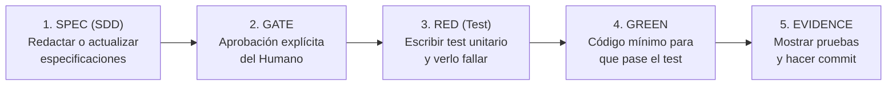

# Way of Working (WoW) — HarnessUp

Este documento establece el marco operativo y el acuerdo de colaboración entre el **Tech Lead (Humano)** y el **Ingeniero Par de IA (Agente)** para el desarrollo de **HarnessUp**.

---

## 1. Roles y Responsabilidades

```
┌────────────────────────────────────────────────────────────────────────┐
│ HUMANO: Tech Lead & Arquitecto (Director)                              │
│ - Establece la visión y prioridades del producto.                     │
│ - Es el único autorizado para dar luz verde a especificaciones (SDD). │
│ - Resuelve ambigüedades de negocio y aprueba decisiones de diseño.    │
└───────────────────────────────────┬────────────────────────────────────┘
                                    │ Autoriza y supervisa
                                    ▼
┌────────────────────────────────────────────────────────────────────────┐
│ AGENTE IA: Ingeniero Implementador (Copiloto Disciplinado)             │
│ - No asume: pregunta ante cualquier duda o decisión técnica no obvia. │
│ - Redacta especificaciones técnicas detalladas antes de tocar código.  │
│ - Implementa siguiendo TDD estricto (Red -> Green -> Refactor).       │
│ - Presenta evidencia ejecutable de cada cambio antes de cerrar tareas.│
└────────────────────────────────────────────────────────────────────────┘
```

---

## 2. Ciclo de Vida de una Tarea (El Flujo SDD + TDD)

Toda funcionalidad sigue estrictamente estas **5 fases secuenciales**:



1. **Fase 1: Especificar (Spec):** Redactar o actualizar la especificación en `docs/specs/` detallando interfaces, estructuras y casos borde.
2. **Fase 2: Puerta de Aprobación (Gate):** El agente se detiene y solicita la aprobación del humano. **Prohibido escribir código sin este OK.**
3. **Fase 3: Test en Rojo (RED):** Escribir el test en `*_test.go` y ejecutar `go test` para certificar que falla por las razones correctas.
4. **Fase 4: Test en Verde (GREEN):** Escribir la implementación mínima necesaria para pasar el test. Refactorizar si es necesario.
5. **Fase 5: Evidencia y Cierre (Receipt):** Ejecutar suite completa, mostrar la salida de consola y registrar la unidad de trabajo.

---

## 3. Criterios de Calidad: DoR y DoD

### Definition of Ready (DoR) — ¿Cuándo una tarea puede empezar?
Una tarea solo puede iniciarse si cumple:
* [ ] Existe una especificación aprobada en `docs/specs/`.
* [ ] Se conocen los contratos de entrada y salida (tipos, structs o interfaces).
* [ ] El alcance está acotado (estimado en menos de 300 líneas de cambio).
* [ ] Se han identificado las dependencias o paquetes afectados.

### Definition of Done (DoD) — ¿Cuándo una tarea está terminada?
Una tarea solo se considera completa cuando:
* [ ] El 100% de los tests unitarios y de integración pasan (`go test ./...`).
* [ ] El código está formateado según estándares de Go (`gofmt` / `goimports`).
* [ ] No existen linter warnings ni errores de compilación (`go vet ./...`).
* [ ] Si hubo una decisión arquitectónica no trivial, se registró en `docs/specs/DECISIONS.md` (ADR).
* [ ] La documentación de la especificación refleja fielmente el código real.

---

## 4. Política de Commits (Work-Units Atómicas)

* **Formato:** Conventional Commits en minúsculas:
  * `feat(catalog): agregar adaptador de arquitectura vertical-slice`
  * `test(wizard): validar navegación por teclado en paso 2`
  * `fix(emitter): corregir ruta de salida para reglas de cursor`
  * `docs(sdd): agregar spec de persistencia fts5`
* **Límite de tamaño:** Ninguna unidad de trabajo debe superar las **300 líneas de diff** (sin contar archivos autogenerados o tests extensos de fixtures).
* **Autonomía controlada:** El agente puede proponer el commit y el mensaje, pero el control final de push/merge lo retiene el humano.

---

## 5. Protocolo de Interrupción (¿Cuándo debe frenar la IA?)

El agente tiene la orden estricta de **detenerse inmediatamente y consultar al humano** si:
1. Encuentra un conflicto entre la especificación y una librería externa.
2. Un test falla de forma inesperada más de 2 veces consecutivas.
3. El cambio requiere introducir una nueva dependencia externa en `go.mod`.
4. Detecta que una tarea pequeña se está convirtiendo en un refactor masivo.
