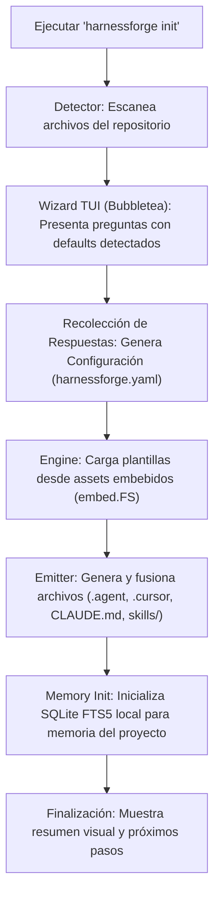

# SPEC-001: Visión, Objetivos y Arquitectura del Sistema

* **Proyecto:** HarnessForge
* **Estado:** Propuesto (Pendiente de Aprobación)
* **Fecha:** 2026-10-14
* **Metodología:** Spec-Driven Development (SDD)

---

## 1. Declaración del Problema y Visión

### 1.1 El Problema
Al desarrollar software con agentes de Inteligencia Artificial (Claude Code, Cursor, Antigravity, OpenCode, Pi, etc.), los desarrolladores sufren de:
1. **Deriva y Alucinación:** Los agentes modifican archivos no relacionados, inventan convenciones o ignoran la arquitectura del proyecto si no se les imponen reglas explícitas.
2. **Amnesia de Contexto:** Cada nueva sesión o compactación de contexto olvida las decisiones arquitectónicas previas.
3. **Falta de Estandarización:** Cada desarrollador del equipo configura sus reglas de forma artesanal o incompleta, creando inconsistencias.
4. **Acoplamiento a una sola herramienta:** Cambiar de Cursor a Claude Code o Antigravity implica reescribir reglas, skills y prompts a mano.

### 1.2 La Visión
**HarnessForge** es una herramienta de línea de comandos (CLI) en Go, interactiva y extensible, que permite a cualquier desarrollador o equipo **generar, personalizar y sincronizar arneses de ingeniería deterministas** para cualquier proyecto de software, adaptados a su stack, arquitectura y herramientas de IA preferidas.

---

## 2. Objetivos y Alcance

### 2.1 Objetivos Principales (In-Scope)
* **Catálogo Unificado:** Alojar un catálogo curado de arneses de la industria (memoria SQLite FTS5, TDD estricto, ODD, convenciones de arquitectura, guardrails de seguridad).
* **Asistente Interactivo (TUI):** Una interfaz de terminal moderna (con Bubbletea) que guía al usuario mediante preguntas intuitivas para calibrar el arnés del proyecto.
* **Auto-Detección Inteligente:** Analizar los archivos del repositorio (`package.json`, `*.csproj`, `go.mod`, `pyproject.toml`) para sugerir respuestas por defecto en el asistente.
* **Emisión Multi-Agente:** Generar la configuración en los formatos nativos correspondientes (`.agent/rules/`, `.cursor/rules/`, `CLAUDE.md`, `.windsurfrules`, `.opencode/`, etc.).
* **Memoria Persistente Integrada:** Proporcionar una base de datos local SQLite con FTS5 para retener decisiones y arquitectura.
* **Idempotencia y Sincronización:** Capacidad de actualizar o regenerar arneses (`harnessforge sync`) sin sobreescribir personalizaciones del usuario.

### 2.2 Fuera de Alcance (Out-of-Scope)
* HarnessForge **no** es un modelo de lenguaje ni un LLM propietario.
* HarnessForge **no** reemplaza al IDE ni al cliente de IA; provee el arnés que los gobierna.

---

## 3. Arquitectura del Sistema en Go

El proyecto seguirá la estructura idiomática de Go (`Standard Go Project Layout`):

```text
HarnessCraft/
├── cmd/
│   └── harnessforge/                # Punto de entrada principal (main.go)
├── internal/
│   ├── app/                         # Orquestación de comandos Cobra (init, sync, doctor)
│   ├── wizard/                      # Motor interactivo Bubbletea (TUI)
│   │   ├── model.go                 # Estado de la máquina TUI
│   │   ├── view.go                  # Renderizado con Lipgloss
│   │   └── update.go                # Manejador de eventos de teclado
│   ├── detector/                    # Análisis del repositorio para auto-detección de stack
│   ├── catalog/                     # Registro de arneses disponibles (memoria, reglas, skills)
│   │   ├── memory.go
│   │   ├── workflows.go
│   │   ├── architectures.go
│   │   └── agents.go
│   ├── engine/                      # Motor de renderizado de plantillas y compilación
│   ├── emitter/                     # Generador de archivos hacia los destinos (.agent, .cursor, etc.)
│   └── memory/                      # Gestor de base de datos SQLite + FTS5 local
├── assets/                          # Plantillas embebidas en el binario (embed.FS)
│   ├── skills/                      # SKILL.md organizados por categorías
│   ├── rules/                       # Fragmentos de reglas modulares
│   └── templates/                   # Plantillas maestras de configuración
└── docs/
    └── specs/                       # Especificaciones SDD y ADRs
```

---

## 4. Ciclo de Vida de Ejecución (`harnessforge init`)



---

## 5. Criterios de Aceptación de la Arquitectura y Preservación de Contexto (Anti-Context Rot)

1. **Compilación Nativa:** La aplicación debe compilar a un binario único ejecutable sin dependencias externas.
2. **Embebido de Assets:** Todas las plantillas y skills deben estar embebidas en el binario usando `//go:embed`.
3. **Velocidad Extrema:** El tiempo de ejecución del escaneo y la generación debe ser inferior a 500 ms.
4. **Preservación de Contexto (Anti-Context Rot):**
   * **Carga Perezosa (Lazy-Loading):** Las skills y reglas no deben inyectarse en bloque. Deben cargarse únicamente bajo demanda cuando el prompt lo requiera.
   * **Memoria Quirúrgica vía SQLite FTS5:** Las consultas de contexto pasado deben recuperar únicamente fragmentos acotados (máximo 500 tokens por consulta relevante), evitando arrastrar historiales de chat degradados.
   * **Filtrado por Globs:** Los emisores compatibles (Cursor, Antigravity) deben acotar las reglas por patrones de archivo (`globs`) para no contaminar el contexto con instrucciones irrelevantes a la tarea activa.
   * **Work-Units Compactables:** Las unidades de trabajo limitadas a 300 líneas garantizan que cualquier sesión puede reiniciarse o compactarse sin pérdida de arquitectura, ya que el estado se preserva en `docs/specs/` y Git.
5. **Operación Local-First:** El sistema debe operar completamente sin conexión a internet.
