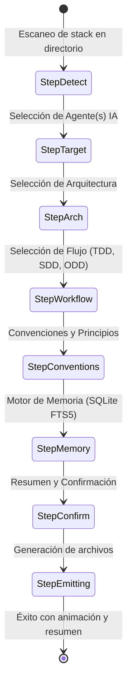

# SPEC-003: Diseño de la Interfaz de Línea de Comandos (CLI) y TUI con Bubbletea

* **Proyecto:** HarnessForge
* **Estado:** Propuesto (Pendiente de Aprobación)
* **Fecha:** 2026-10-14
* **Metodología:** Spec-Driven Development (SDD)

---

## 1. Experiencia de Usuario (UX)

HarnessForge está diseñado como una herramienta de terminal inmersiva, clara y moderna, siguiendo el estilo de herramientas como `gh`, `gum` y los componentes de **Charm.sh** (`bubbletea` + `lipgloss`).

### 1.1 Comandos Principales (Cobra CLI)

```bash
# Inicializa interactivamente el arnés en el repositorio actual
harnessforge init

# Sincroniza o actualiza los archivos del arnés según harnessforge.yaml
harnessforge sync

# Diagnostica la salud del arnés y verifica que el agente cumpla las reglas
harnessforge doctor

# Agrega una nueva skill o regla al arnés del proyecto
harnessforge add skill <skill-name>
harnessforge add rule <rule-name>

# Consulta la memoria persistente del proyecto (FTS5)
harnessforge memory query "decisión arquitectura base de datos"
```

---

## 2. Máquina de Estados del Wizard Interactivo (`bubbletea`)

Cuando el usuario ejecuta `harnessforge init`, la TUI pasa secuencialmente por **6 pasos**:



---

## 3. Detalle de los Pasos del Wizard

### Paso 1: Detección Automática y Bienvenida
Muestra un banner estilizado con `lipgloss` y el stack detectado:
```text
  ⚡ HarnessForge v0.1.0 — Deterministic AI Engineering Harness
  -------------------------------------------------------------
  ✓ Repositorio detectado: C# (.NET 9) en 'K:\GitHub\Lowcord'
  ✓ Suite de tests: xUnit / NUnit
```

### Paso 2: ¿Qué agentes de IA utilizarás en este proyecto?
*Tipo: Multiselect con checkboxes (`[x]`)*
* `[x] Google Antigravity` (Detectado / Recomendado)
* `[ ] Cursor`
* `[ ] Claude Code`
* `[ ] Windsurf`
* `[ ] Todos (Multi-Agente Universal)`

### Paso 3: ¿Qué patrón de arquitectura gobierna el proyecto?
*Tipo: Single-select con descripción explicativa*
* `[●] Vertical Slice Architecture` (Features independientes con Command/Query, DTO y tests)
* `[ ] Clean Architecture` (Capas concéntricas: Domain, Application, Infrastructure, API)
* `[ ] Hexagonal Architecture` (Ports & Adapters)
* `[ ] Modular Monolith`

### Paso 4: Metodología y Flujo de Trabajo
*Tipo: Multiselect*
* `[x] Spec-Driven Development (SDD): Prohibido codear sin especificación técnica aprobada`
* `[x] TDD Estricto: Test Rojo -> Verde -> Refactor antes de tocar código productivo`
* `[x] Commits Atómicos (Work-Units): Límite de 300 líneas de diff por tarea`

### Paso 5: Principios y Naming
*Tipo: Multiselect y selector de estilo*
* `[x] SOLID estricto (prohibir clases > 200 líneas y métodos > 30 líneas)`
* `[x] Inmutabilidad por defecto`
* Convención de nomenclatura:
  * `[●] C# Standard (PascalCase para clases/métodos, camelCase campos privados)`
  * `[ ] camelCase universal`
  * `[ ] snake_case`

### Paso 6: Persistencia y Memoria
*Tipo: Single-select*
* `[●] SQLite FTS5 Local (Búsqueda de texto completo ultrarrápida en .harness/memory.db)`
* `[ ] Archivos Markdown planos (docs/decisions/ y docs/memory.md)`
* `[ ] Ninguna`

---

## 4. Navegación por Teclado
* `↑ / k`: Mover hacia arriba.
* `↓ / j`: Mover hacia abajo.
* `Espacio`: Seleccionar / deseleccionar checkbox.
* `Enter`: Confirmar paso y avanzar al siguiente.
* `Esc / q`: Cancelar ejecución sin alterar archivos.

---

## 5. Modo No Interactivo (CI / Automatización)
Permite generar arneses mediante flags sin abrir la TUI:

```bash
harnessforge init \
  --agent=antigravity \
  --arch=vertical-slice \
  --workflow=sdd,tdd \
  --memory=sqlite-fts5 \
  --non-interactive
```
