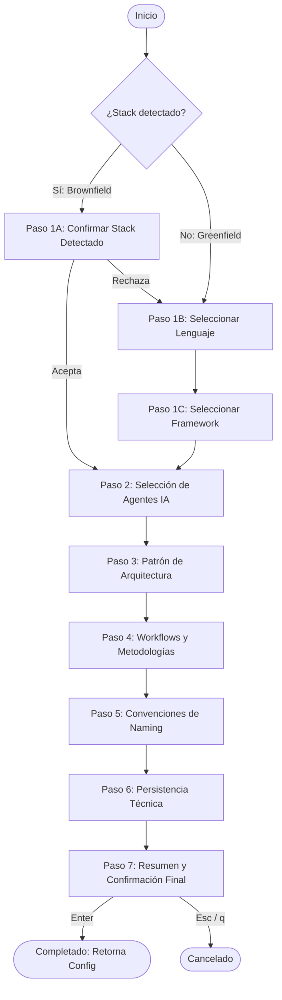

# SPEC-009: Especificación Técnica — Wizard Interactivo TUI (FEAT-005)

* **Proyecto:** HarnessUp
* **Feature ID:** `FEAT-005`
* **Estado:** Completado (Verificado con Evidencia)
* **Fecha:** 2026-10-15
* **Metodología:** Spec-Driven Development (SDD) & TDD Estricto
* **Rama Planificada:** `feat/feat-005-tui-wizard`

---

## 1. Resumen y Objetivos

El objetivo de esta unidad de trabajo es implementar el subsistema de **Asistente de Terminal Interactivo** (`internal/wizard`):
1. Construir la máquina de estados interactiva para consola utilizando **Bubbletea** (`github.com/charmbracelet/bubbletea`) con renderizado y estilos limpios mediante **Lipgloss** (`github.com/charmbracelet/lipgloss`).
2. Soportar el flujo dual acordado en **ADR-004**:
   * **Modo Brownfield:** Autodetección del stack (`internal/detector`) con confirmación interactiva para reutilizar lenguaje, framework y test runner existentes.
   * **Modo Greenfield:** Si el detector retorna `unknown` (o el usuario elige reconfigurar), el asistente despliega selectores guiados para elegir lenguaje y framework base.
3. Guiar al usuario paso a paso por los agentes objetivo (`targets`), patrón de arquitectura (`architecture`), workflows metodológicos (`workflows`), convenciones de nomenclatura (`conventions`) y motor de persistencia (`memory`).
4. Generar como resultado un objeto `*config.Config` válido y listo para ser guardado en `harnessup.yaml` y emitido mediante `internal/emitter`.
5. Diseñar el modelo `tea.Model` de forma 100% testeable en modo headless (pasando `tea.KeyMsg` a `Update` sin depender de una TTY interactiva física).

---

## 2. Máquina de Estados y Pasos del Wizard

### 2.1 Flujo de Estados



---

## 3. Contratos y Estructuras de Datos

### 3.1 Estructuras del Modelo (`internal/wizard/model.go`)

```go
package wizard

import (
    tea "github.com/charmbracelet/bubbletea"
    "github.com/FakuInsa/harness-up/internal/config"
    "github.com/FakuInsa/harness-up/internal/detector"
)

// Step identifica cada etapa secuencial del wizard.
type Step int

const (
    StepDetectConfirm Step = iota
    StepSelectLanguage
    StepSelectFramework
    StepSelectTargets
    StepSelectArchitecture
    StepSelectWorkflows
    StepSelectNaming
    StepSelectMemory
    StepSummary
    StepFinished
)

// OptionItem representa un elemento seleccionable en una lista del wizard.
type OptionItem struct {
    Key         string
    Label       string
    Description string
}

// WizardModel encapsula el estado reactivo del asistente Bubbletea.
type WizardModel struct {
    step         Step
    stack        *detector.StackInfo
    config       *config.Config
    cursor       int
    selectedKeys map[string]bool // Para selecciones múltiples (targets, workflows)
    confirmed    bool
    aborted      bool
    err          error
}

// NewModel inicializa un WizardModel a partir del stack detectado y directorio.
func NewModel(projectName string, stack *detector.StackInfo) *WizardModel

// Init inicializa el comando Bubbletea (tea.Model).
func (m *WizardModel) Init() tea.Cmd

// Update procesa mensajes reactivos de teclado y temporizadores (tea.Model).
func (m *WizardModel) Update(msg tea.Msg) (tea.Model, tea.Cmd)

// View renderiza visualmente la pantalla activa con Lipgloss (tea.Model).
func (m *WizardModel) View() string

// Config retorna la configuración final construida tras el cierre exitoso.
func (m *WizardModel) Config() *config.Config

// IsDone indica si el asistente finalizó satisfactoriamente.
func (m *WizardModel) IsDone() bool

// IsAborted indica si el usuario canceló la ejecución.
func (m *WizardModel) IsAborted() bool
```

### 3.2 Función de Entrada (`internal/wizard/wizard.go`)

```go
package wizard

import "github.com/FakuInsa/harness-up/internal/config"

// Run inicia la ejecución interactiva en la terminal y retorna el Config resultante.
func Run(dirPath string) (*config.Config, error)
```

---

## 4. Opciones Predefinidas por Paso

1. **Lenguajes Greenfield:**
   * `csharp`: C# / .NET
   * `typescript`: TypeScript / Node.js
   * `python`: Python
   * `go`: Go (Golang)
2. **Frameworks Greenfield:**
   * C#: `aspnetcore-webapi`, `minimal-apis`, `console`
   * TypeScript: `nestjs`, `express`, `nextjs`
   * Python: `fastapi`, `django`, `flask`
   * Go: `standard`, `gin`, `fiber`
3. **Agentes IA (`targets` - Multiselect):**
   * `antigravity`: Google Antigravity (Recomendado)
   * `cursor`: Cursor IDE (.mdc rules)
4. **Arquitectura (`architecture` - Single select):**
   * `vertical-slice`: Vertical Slice Architecture (Recomendado)
   * `clean`: Clean Architecture (Domain, Application, Infra)
   * `hexagonal`: Ports & Adapters
   * `hybrid`: Híbrida / Personalizada
5. **Workflows (`workflows` - Multiselect):**
   * `sdd`: Spec-Driven Development (No code without spec)
   * `tdd-strict`: Test-Driven Development (Red -> Green -> Refactor)
   * `atomic-commits`: Unidades de trabajo atómicas (< 300 líneas)
6. **Convenciones de Naming (`naming` - Single select):**
   * `standard`: Convención canónica del lenguaje
   * `snake_case`: snake_case estricto
   * `pascal_case`: PascalCase
   * `camel_case`: camelCase
7. **Memoria (`memory` - Single select):**
   * `sqlite-fts5`: SQLite embebido con Full-Text Search (.harness/memory.db)
   * `markdown`: Archivos Markdown planos
   * `none`: Sin persistencia de decisiones

---

## 5. Dependencias Externas

* `github.com/charmbracelet/bubbletea`: Motor TUI reactivo (ADR-002).
* `github.com/charmbracelet/lipgloss`: Motor de estilos de terminal (ADR-002).

---

## 6. Estrategia de TDD (Rojo $\rightarrow$ Verde $\rightarrow$ Refactor)

1. **Paso RED:**
   * Instalar dependencias `bubbletea` y `lipgloss` en `go.mod`.
   * Crear `internal/wizard/wizard_test.go` cubriendo:
     * `TestWizard_BrownfieldFlow`: Simula detección de C# -> confirmación -> selección de target y arquitectura -> verificación de `Config()` resultante válido.
     * `TestWizard_GreenfieldFlow`: Simula stack `unknown` -> selección de lenguaje Go -> framework -> confirmación final.
     * `TestWizard_MultiselectToggle`: Verifica que la tecla `Space` alterna selección en targets y workflows.
     * `TestWizard_Abort`: Verifica que presionar `ctrl+c` o `esc` marca `IsAborted() == true` sin generar configuración errónea.
     * `TestWizard_ResultValid`: Valida que el `Config()` emitido pasa `cfg.Validate()` sin errores.
   * Ejecutar `go test ./internal/wizard/...` y certificar estado RED.
2. **Paso GREEN:**
   * Implementar `internal/wizard/model.go`, `internal/wizard/view.go` y `internal/wizard/wizard.go`.
   * Verificar que todos los tests pasen (GREEN).
3. **Paso REFACTOR & RECEIPT:**
   * Cobertura $\ge 85\%$.
   * `go vet ./...` y `gofmt` limpios.
   * Diff productivo menor a 300 líneas.

---

## 7. Criterios de Aceptación (DoD)

* [ ] Modelo `WizardModel` implementa `tea.Model` (`Init`, `Update`, `View`).
* [ ] Soporte dual Brownfield y Greenfield funcional según ADR-004.
* [ ] Navegación por teclado completa (`↑/↓/j/k`, `Space`, `Enter`, `Esc/Ctrl+C`).
* [ ] El `Config()` resultante es 100% válido según `config.Validate()`.
* [ ] 100% de tests unitarios pasando en modo headless con cobertura $\ge 85\%$.
* [ ] Diff productivo menor a 300 líneas.
